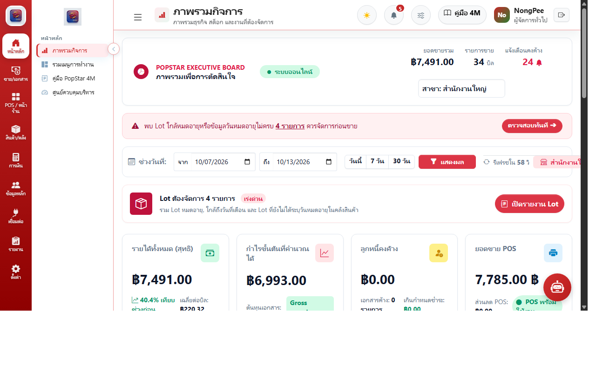
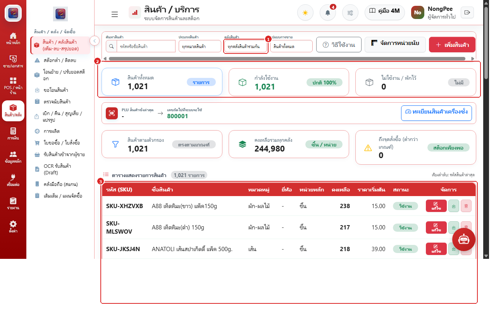
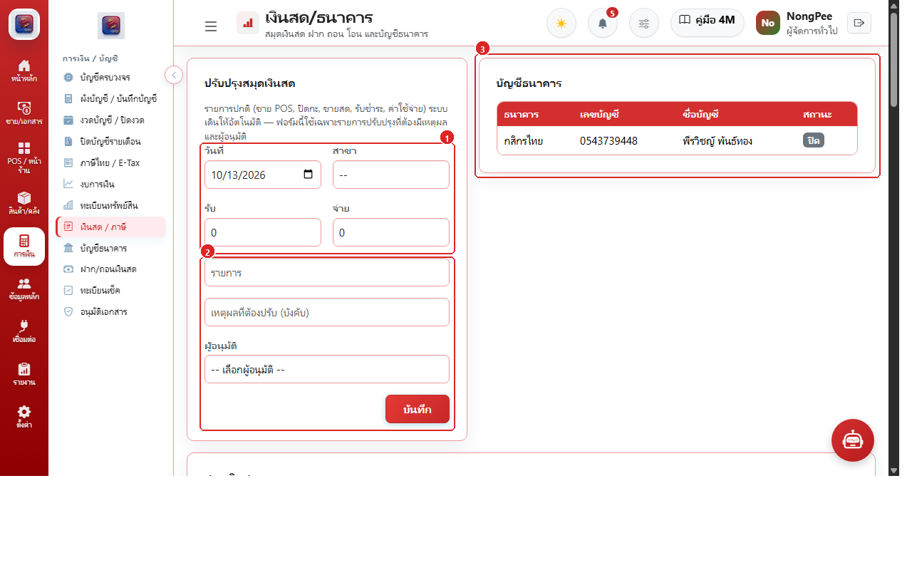

# 🌟 POP ERP Food & JET POS System

<p align="center">
  
</p>

<p align="center">
  <strong>ระบบบริหารจัดการร้านอาหาร ภัตตาคาร และค้าปลีกแบบครบวงจร (Full-Stack ERP & Offline-First POS)</strong><br />
  รองรับการขายหน้าร้านแบบสัมผัส (Touchscreen), การทำงานออฟไลน์, จัดการสต็อกสินค้า วัตถุดิบ ผังบัญชี และศูนย์ภาษี
</p>

<p align="center">
  
  
  
  
  
  
</p>

---

## 📌 จุดเด่นของระบบ (Core Features)

1. **ERP Backend & Executive Dashboard**: ศูนย์ควบคุมการบริหารแบบรวมศูนย์ ติดตามยอดขาย กำไร และสถานะการทำงานแบบ Real-time
2. **JET POS (Python Touchscreen Client)**: โปรแกรมขายหน้าร้านออฟไลน์ พร้อมจอสองสำหรับลูกค้า (Customer Display), พิมพ์สลิปความร้อน 80mm/58mm และเชื่อมโยงลิ้นชักเก็บเงิน
3. **ระบบจัดการสินค้า วัตถุดิบ และสูตรการผลิต (BOM)**: รองรับการตัดสต็อกวัตถุดิบอัตโนมัติเมื่อขายหน้าร้าน, ตรวจนับสต็อก และโอนสินค้าระหว่างสาขา
4. **ระบบการเงินและบัญชีครบวงจร (Finance & Accounting)**: สมุดเงินสด, ทะเบียนบัญชีธนาคาร, ทะเบียนเช็ค, ผังบัญชี (Chart of Accounts), สมุดรายวันทั่วไป (GL), งบการเงิน และศูนย์ภาษีไทย (ภ.พ.30 / ภ.ง.ด.3 / ภ.ง.ด.53 / E-Tax Invoice)
5. **คู่มือระบบแบบ Interactive (Built-in Visual Reader)**: หน้าอ่านคู่มือ `/manual` และ `/core-modules` พร้อมภาพประกอบและคอลเอาต์อธิบายทุกหน้าจอ

---

## 📸 ภาพตัวอย่างระบบ (System Preview)

### 1. ศูนย์ควบคุมบริหาร (Executive Dashboard)


### 2. ระบบขายหน้าร้าน JET POS (Python Desktop Client)


### 3. ระบบจัดการสินค้าและราคา (Products Master & Pricing)


### 4. ระบบการเงินและสมุดเงินสด (Finance & Cash Books)


---

## 🛠️ ข้อกำหนดเบื้องต้น (Prerequisites)

- **ระบบปฏิบัติการ**: Windows 10/11 หรือ Linux (Ubuntu 22.04+)
- **Git**: สำหรับโคลนโปรเจกต์
- **Docker & Docker Compose** *(แนะนำสำหรับการรัน ERP Backend)* **หรือ**:
  - PHP 8.3+ พร้อมส่วนขยาย (pdo_pgsql, pdo_sqlite, gd, zip, curl, mbstring, bcmath)
  - Composer 2.7+
  - Node.js 20+ และ pnpm (หรือ npm)
  - PostgreSQL 15+ หรือ SQLite
- **Python 3.10 - 3.14**: สำหรับการรันระบบหน้าร้าน JET POS

---

## 🚀 คู่มือการติดตั้งทีละขั้นตอน (Step-by-Step Installation Guide)

### ขั้นตอนที่ 1: โคลนโปรเจกต์ (Clone Repository)

เปิด Command Prompt หรือ Terminal แล้วรันคำสั่ง:

```bash
git clone https://github.com/nongpee321/popstarshop.git
cd popstarshop
```

---

### ขั้นตอนที่ 2: ติดตั้งและรันระบบจัดการหลังบ้าน (ERP Backend)

สามารถเลือกติดตั้งได้ 2 รูปแบบ:

#### 🔷 รูปแบบ A: ติดตั้งด้วย Docker (แนะนำ - ง่ายและรวดเร็วที่สุด)

1. คัดลอกไฟล์ Environment:
   ```bash
   cp .env.example .env
   ```
2. สตาร์ท Container ระบบ (Laravel, PostgreSQL 15, Adminer):
   ```bash
   docker compose up -d
   ```
3. รัน Migration และสร้างคีย์ระบบ:
   ```bash
   docker exec -it pop_erp_app php artisan key:generate
   docker exec -it pop_erp_app php artisan migrate --seed
   docker exec -it pop_erp_app php artisan storage:link
   ```
4. เข้าใช้งานระบบ:
   - **ระบบ ERP**: [http://localhost:8000](http://localhost:8000)
   - **Adminer (จัดการฐานข้อมูล)**: [http://localhost:8080](http://localhost:8080)
   - **คู่มือการใช้งานระบบ**: [http://localhost:8000/manual](http://localhost:8000/manual)

---

#### 🔶 รูปแบบ B: ติดตั้งบนเครื่องโดยตรง (Manual Setup with PHP & Composer)

1. คัดลอกและตั้งค่า Environment:
   ```bash
   cp .env.example .env
   ```
   *(แก้ไขการเชื่อมต่อฐานข้อมูลใน `.env` เช่น `DB_CONNECTION=pgsql` หรือ `sqlite`)*

2. ติดตั้ง Dependencies ฝั่ง Backend และ Frontend:
   ```bash
   composer install
   npm install && npm run build
   ```

3. สร้าง Application Key และเชื่อมโยง Storage:
   ```bash
   php artisan key:generate
   php artisan storage:link
   ```

4. รัน Database Migration และ Seeder:
   ```bash
   php artisan migrate --seed
   ```

5. เริ่มต้นเซิร์ฟเวอร์ทดสอบ:
   ```bash
   php artisan serve --port=8000
   ```

---

### ขั้นตอนที่ 3: ติดตั้งและรันระบบหน้าร้าน JET POS (Python Desktop Client)

ระบบหน้าร้านพัฒนาด้วย Python (PyQt6) อยู่ในโฟลเดอร์ `apps/python-pos`

```bash
cd apps/python-pos
```

1. **สร้างและเปิดใช้งาน Virtual Environment:**
   - **บน Windows:**
     ```powershell
     python -m venv venv
     .\venv\Scripts\activate
     ```
   - **บน Linux / macOS:**
     ```bash
     python3 -m venv venv
     source venv/bin/activate
     ```

2. **ติดตั้ง Libraries ที่จำเป็น:**
   ```bash
   pip install -r requirements.txt
   ```

3. **รันโปรแกรม POS:**
   ```bash
   python main.py
   ```

4. **การ Build เป็นไฟล์ `.exe` สำหรับติดตั้งหน้าร้าน (Standalone):**
   ```powershell
   powershell -ExecutionPolicy Bypass -File .\build_pos.ps1
   ```
   ไฟล์ผลลัพธ์ตัวติดตั้งจะอยู่ที่โฟลเดอร์ `dist/`

---

## 🔑 ข้อมูลเข้าสู่ระบบเริ่มต้น (Default Credentials)

- **ผู้ดูแลระบบสูงสุด (Super Administrator)**:
  - **Username / Email**: `admin` หรือ `nongpee`
  - **Password**: `password` หรือรหัสผ่านที่กำหนดใน Seeder
- **พนักงานแคชเชียร์หน้าร้าน (Cashier)**:
  - **PIN**: `1234` หรือ `0000`

---

## 📖 คู่มือการใช้งานและเอกสารมาตรฐาน 8 บท (Standard Operating Procedures - SOP)

ระบบจัดเตรียมคู่มือการปฏิบัติงานมาตรฐานไว้ทั้งในรูปแบบ **Web Interactive Reader** และเอกสาร **Offline Markdown** แบ่งออกเป็น **8 บทหลัก**:

| บทที่ | ชื่อบทและเนื้อหา | เอกสารออฟไลน์ (Docs) | เว็บคู่มือ (Interactive) |
| :---: | :--- | :---: | :---: |
| **บทที่ 1** | **ภาพรวมระบบและการเริ่มต้นใช้งาน (Getting Started & Overview)**<br>• 1.1 ภาพรวมและศูนย์ควบคุมผู้บริหาร (9 ฟังก์ชัน)<br>• 1.2 การจัดการผู้ใช้ สิทธิ์ และความปลอดภัย (8 ฟังก์ชัน)<br>• 1.3 การตั้งค่าระบบ สาขา และเอกสาร (14 ฟังก์ชัน) | [📖 Chapter 1](docs/manual/Chapter_01_Overview_and_Setup.md) | [เปิดอ่าน](http://localhost:8000/manual#guide-overview) |
| **บทที่ 2** | **ระบบขายหน้าร้าน (Point of Sale - JET POS v1.12.23)**<br>• 2.1 โปรแกรมแคชเชียร์จอสัมผัส (Python Desktop POS v1.12.23 - 6 ขั้นตอน)<br>• 2.2 ขั้นตอนการขายหน้าร้าน (JET POS v1.12.23 - 5 ขั้นตอน) | [📖 Chapter 2](docs/manual/Chapter_02_Point_of_Sale.md) | [เปิดอ่าน](http://localhost:8000/manual#guide-python-pos) |
| **บทที่ 3** | **ระบบสินค้าและคลังสินค้า (Inventory & Warehousing)**<br>• 3.1 ทะเบียนสินค้าและสต็อกคงเหลือ (5 ขั้นตอน)<br>• 3.2 การโอนย้ายสต็อกข้ามสาขา (4 ขั้นตอน)<br>• 3.3 การตรวจนับสต็อกสินค้าจริง (4 ขั้นตอน)<br>• 3.4 ข้อมูลหลัก วัตถุดิบ และสูตรการผลิต BOM (13 ฟังก์ชัน) | [📖 Chapter 3](docs/manual/Chapter_03_Inventory_and_Warehouse.md) | [เปิดอ่าน](http://localhost:8000/manual#guide-products) |
| **บทที่ 4** | **ระบบการขายและเอกสารลูกค้า (Sales & Invoicing)**<br>• 4.1 ศูนย์เอกสารการขาย ใบเสนอราคา ใบแจ้งหนี้ ใบเสร็จ และ CRM (9 ฟังก์ชัน) | [📖 Chapter 4](docs/manual/Chapter_04_Sales_and_Customers.md) | [เปิดอ่าน](http://localhost:8000/manual#guide-sales) |
| **บทที่ 5** | **ระบบการจัดซื้อและเจ้าหนี้ (Purchasing & Payables)**<br>• 5.1 การจัดซื้อ คลังวัตถุดิบ ใบสั่งซื้อ (PO) และการผลิต (6 ฟังก์ชัน) | [📖 Chapter 5](docs/manual/Chapter_05_Purchasing_and_Suppliers.md) | [เปิดอ่าน](http://localhost:8000/manual#guide-purchasing) |
| **บทที่ 6** | **ระบบการเงิน บัญชี และภาษี (Finance, Accounting & Tax)**<br>• 6.1 สมุดเงินสด ธนาคาร เช็ค ผังบัญชี GL งบการเงิน และศูนย์ภาษี E-Tax (8 ฟังก์ชัน) | [📖 Chapter 6](docs/manual/Chapter_06_Finance_and_Accounting.md) | [เปิดอ่าน](http://localhost:8000/manual#guide-finance) |
| **บทที่ 7** | **รายงานและการวิเคราะห์เชิงบริหาร (Reports & Business Intelligence)**<br>• 7.1 รายงานยอดขาย จัดซื้อ สต็อก การเงิน ภาษี และส่งออก Excel/PDF (6 ฟังก์ชัน) | [📖 Chapter 7](docs/manual/Chapter_07_Reports_and_Analytics.md) | [เปิดอ่าน](http://localhost:8000/manual#guide-reports) |
| **บทที่ 8** | **การเชื่อมต่อภายนอกและการดูแลระบบ (Integrations & Operations)**<br>• 8.1 การเชื่อมต่อ LINE Notify, Webhook, API และการ Backup/Restore (1 ฟังก์ชัน) | [📖 Chapter 8](docs/manual/Chapter_08_Integrations_and_Maintenance.md) | [เปิดอ่าน](http://localhost:8000/manual#guide-integrations) |

> 📑 **สารบัญรวมทั้งหมด**: ดูรายละเอียดเต็มได้ที่ [docs/manual/README.md](docs/manual/README.md)
>
> 🖥️ **ช่องทางการเข้าถึงบนระบบออนไลน์**:
> - **คู่มือสาธารณะสำหรับพนักงาน**: [http://localhost:8000/manual](http://localhost:8000/manual)
> - **ระบบอ่านคู่มือ 4M ภายใน ERP**: [http://localhost:8000/core-modules](http://localhost:8000/core-modules)
> - **ความช่วยเหลือใน JET POS**: กดปุ่ม `F1` หรือไอคอนคู่มือบนหน้าจอสัมผัส POS

---

## 📂 โครงสร้างโฟลเดอร์หลัก (Project Structure)

```text
popstarshop/
├── app/                      # Laravel Controllers, Models, Services, Policies
├── apps/
│   └── python-pos/           # Python Desktop POS (PyQt6, Offline Sync, ESC/POS)
│       ├── ui/               # Touchscreen Windows & Dialogs
│       ├── services/         # Sync Worker & Offline SQLite Manager
│       ├── tests/            # Automated Unit & UI Tests
│       ├── build_pos.ps1     # Build Script to compile .exe
│       └── main.py           # Application Entry Point
├── database/                 # Migrations & Seeders
├── docker-compose.yml        # Docker Architecture (App, PostgreSQL, Adminer)
├── public/
│   └── images/
│       └── manual/           # คู่มือภาพประกอบพร้อม Callouts รวม 98 ขั้นตอน
├── resources/
│   └── views/
│       ├── manual/           # หน้าเว็บคู่มือสาธารณะ (/manual)
│       ├── core-modules/     # หน้าเว็บระบบอ่านคู่มือ (/core-modules)
│       └── ...               # โมดูล ERP แต่ละส่วน
├── routes/
│   ├── web.php               # Web & API Preview Routes
│   └── api.php               # POS Sync & Mobile API Endpoints
└── tests/                    # Feature & Unit Test Suites (Pest / PHPUnit)
```

---

## 🔒 License & Copyright

© สงวนลิขสิทธิ์ พัฒนาสำหรับระบบบริหารจัดการธุรกิจ **POP STAR Food & Trading Co., Ltd.**
