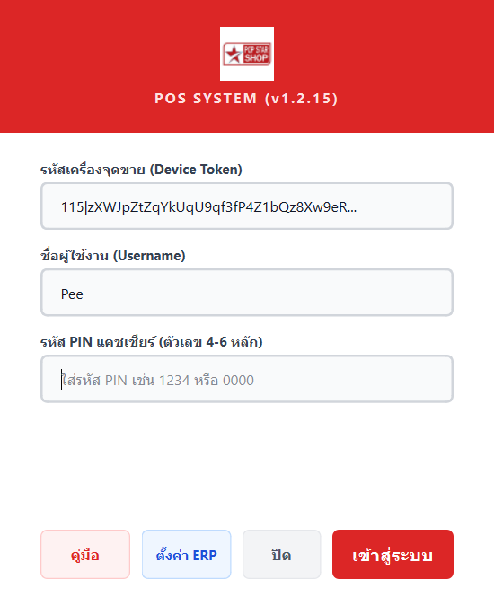
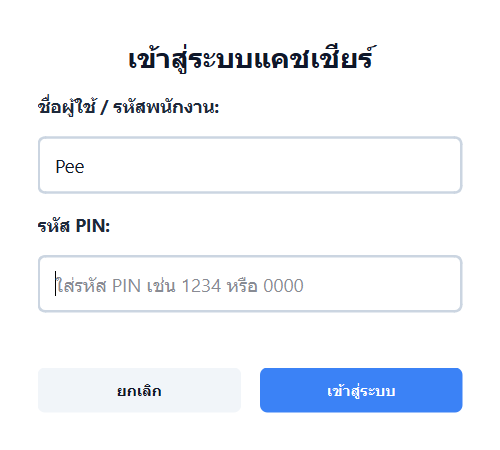
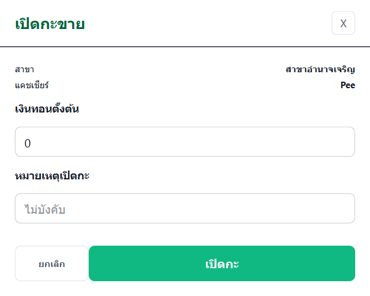
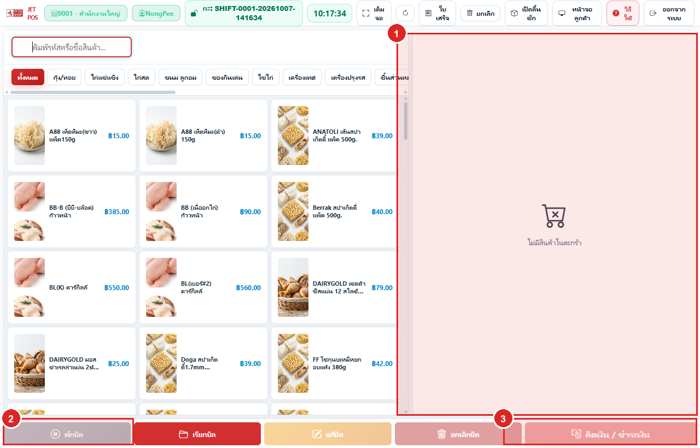

# PopCentral POS (v1.2.15)

ระบบจุดขายหน้าร้านระดับพาณิชย์ (Commercial Desktop POS) พัฒนาด้วย **Python (PySide6 / Qt6)** และ **SQLAlchemy (SQLite)** ออกแบบตามสถาปัตยกรรม **Local-First & Offline-First** สามารถเปิดบิล ขายสินค้า ชั่งน้ำหนัก พิมพ์ใบเสร็จ และรับชำระเงินได้ตลอดเวลาแม้ไม่มีสัญญาณอินเทอร์เน็ต พร้อมระบบ Background Sync อัตโนมัติที่เชื่อมต่อกับ **PopStar ERP Backend**

---

## จุดเด่นของระบบ (Key Features)

- **Local-First Architecture**: ฐานข้อมูล SQLite ในเครื่อง (`%LOCALAPPDATA%\PopCentralPOS\data\pos.db`) ทุกรายการขายจะถูกบันทึกลงเครื่องอย่างสมบูรณ์ก่อนเสมอ ป้องกันข้อมูลสูญหาย 100%
- **Auto Background Synchronization**: ระบบ Worker คอยตรวจสอบสัญญาณอินเทอร์เน็ตและส่งข้อมูลบิลขาย (Outbox Queue) เข้า ERP เซิร์ฟเวอร์แบบ Real-time พร้อมระบบป้องกันบิลซ้ำ (Idempotency Key)
- **เครื่องชั่งน้ำหนักและบาร์โค้ดสินค้าสด (Scale Integration)**: รองรับการอ่านบาร์โค้ดเครื่องชั่งทั้งแบบ Prefix ในร้าน (`800`, `801`, `02`, `20`) และ EAN-13 มาตรฐาน พร้อมระบบแปลงน้ำหนักและราคาอัตโนมัติ
- **ระบบรับชำระเงินครบวงจร (Multi-payment)**:
  - รับเงินสด (Cash) พร้อมคำนวณเงินทอนอัตโนมัติ
  - สแกน QR PromptPay พร้อมระบบสร้าง Dynamic QR ตามยอดเงินจริง
  - บัตรเครดิต และการชำระเงินแบบผสม (Split Payment: เงินสด + โอน)
  - ระบบส่วนลดท้ายบิลและส่วนลดสินค้า คำนวณยอดสุทธิและเงินทอนแม่นยำ
- **ระบบความปลอดภัยแคชเชียร์ (PIN Authentication)**:
  - เข้าใช้งานด้วยรหัส PIN รวดเร็ว ปลอดภัย ไม่ต้องพิมพ์รหัสผ่านยาว
  - จดจำชื่อผู้ใช้ล่าสุดและโฟกัสช่องกรอก PIN ทันที
- **การจัดการกะและรายงาน (Shift & Cash Management)**:
  - บันทึกเงินทอนเริ่มต้นกะ (Opening Cash)
  - รายงานสรุปยอดขายประจำวันและสรุปกะ (Z-Report)
  - ปิดกะพร้อมนับเงินสดจริงและคำนวณยอดเงิน ขาด/เกิน
- **พิมพ์ใบเสร็จและลิ้นชักเก็บเงิน (Thermal Receipt Printer)**:
  - รองรับเครื่องพิมพ์ความร้อน 80mm และ 58mm (ESC/POS, Windows Driver)
  - หน้าต่างตั้งค่าเครื่องพิมพ์พร้อมระบบแสดงตัวอย่างใบเสร็จสด (Live Preview)
  - ปรับขนาดตัวอักษรใบเสร็จได้ (มาตรฐาน / ตัวใหญ่ ชัดเจน)
- **ระบบสำรองข้อมูลอัตโนมัติ (Auto Backup)**:
  - สำรองฐานข้อมูล SQLite อัตโนมัติทุกวันเมื่อเริ่มโปรแกรม ป้องกันเหตุฉุกเฉิน

---

## ความต้องการของระบบ (System Requirements)

| รายการ | ความต้องการขั้นต่ำ | แนะนำ |
|---|---|---|
| **ระบบปฏิบัติการ (OS)** | Windows 10 (64-bit) | Windows 11 (64-bit) |
| **หน่วยประมวลผล (CPU)** | Intel Core i3 / AMD Ryzen 3 | Intel Core i5 หรือเทียบเท่า |
| **หน่วยความจำ (RAM)** | 4 GB | 8 GB ขึ้นไป |
| **พื้นที่ว่างบนฮาร์ดดิสก์** | 500 MB | 2 GB ขึ้นไป (SSD) |
| **เครื่องพิมพ์ใบเสร็จ** | Thermal Printer 58mm / 80mm | Xprinter, Epson, POS-80 |

---

## คู่มือและวิธีติดตั้งโปรแกรม (Installation Guide)

สามารถดาวน์โหลดตัวติดตั้งล่าสุดได้จากเมนู [Releases (v1.2.15)](https://github.com/nongpee321/posCentral/releases/tag/v1.2.15)

### ตัวเลือกที่ 1: ติดตั้งแบบตัวติดตั้งอัตโนมัติ (.exe Setup) — แนะนำสำหรับเครื่องหน้าร้าน

1. ดาวน์โหลดไฟล์ `PopCentral-POS-UAT-1.2.15-setup.exe`
2. ดับเบิลคลิกเปิดไฟล์ติดตั้ง
3. เลือกตำแหน่งติดตั้ง (ค่าเริ่มต้น: `C:\PopCentral POS` หรือ `D:\PopCentral POS`)
4. กดปุ่ม **Extract** หรือ **ติดตั้ง**
5. ตัวติดตั้งจะวางไฟล์ระบบและสร้างทางลัดไอคอน **PopCentral POS** บนหน้าจอ Desktop ให้ทันที

### ตัวเลือกที่ 2: ใช้งานแบบ Portable (.zip ไม่ต้องติดตั้ง)

1. ดาวน์โหลดไฟล์ `PopCentral-POS-Central-UAT-1.2.15-portable.zip`
2. คลิกขวาที่ไฟล์ `.zip` แล้วเลือก **Extract All... (แตกไฟล์ทั้งหมด)** ไปยังโฟลเดอร์ที่ต้องการ เช่น `D:\PopCentral-POS-Central-UAT`
3. ดับเบิลคลิกไฟล์ `PopCentral-POS-Central-UAT.exe` เพื่อเปิดใช้งานได้ทันที

---

## ขั้นตอนการเริ่มใช้งานและตั้งค่าครั้งแรก (Step-by-Step Setup)

### ขั้นตอนที่ 1: ลงทะเบียนเชื่อมต่อเครื่องจุดขายกับระบบ ERP (First-time Device Token Setup)

เมื่อเปิดโปรแกรมครั้งแรกบนเครื่องใหม่ ระบบจะเปิดหน้าต่าง **ลงทะเบียนเครื่องจุดขาย (POS Terminal Setup)**:



1. **รหัสเครื่องจุดขาย (Device Token)**: นำรหัส Token ที่ได้รับจากผู้ดูแลระบบ ERP สำหรับเครื่องสาขานั้นๆ มาวางลงในช่องนี้
2. **ชื่อผู้ใช้งาน (Username)**: ใส่ชื่อผู้ใช้แคชเชียร์ เช่น `Pee`
3. **รหัส PIN แคชเชียร์**: ใส่รหัส PIN ตัวเลข 4-6 หลัก
4. กดปุ่ม **"เข้าสู่ระบบ"** (หรือกดปุ่ม "ตั้งค่า ERP" หากต้องการระบุ Server URL เช่น `https://erp.popstarcenter.com`)
5. ระบบจะดึงฐานข้อมูลสินค้า สาขา และโปรโมชั่นจาก ERP ลงสู่เครื่องโดยอัตโนมัติ

---

### ขั้นตอนที่ 2: การเข้าสู่ระบบแคชเชียร์ประจำวัน (Cashier PIN Login)

สำหรับการเข้างานประจำวันหรือสลับกะพนักงาน:



1. ระบบจะจำชื่อผู้ใช้งานหรือรหัสพนักงานเดิมให้อัตโนมัติ
2. กรอก **รหัส PIN แคชเชียร์** (เช่น `1234` หรือ `0000`)
3. กดปุ่ม **"เข้าสู่ระบบ"** (หรือกดปุ่ม `Enter` บนคีย์บอร์ด)

---

### ขั้นตอนที่ 3: เปิดกะขายและบันทึกเงินทอนเริ่มต้น (Open Shift)

ก่อนเริ่มคิดเงินบิลแรกของวัน แคชเชียร์ต้องทำการเปิดกะ:



1. ตรวจสอบชื่อสาขาและชื่อแคชเชียร์ให้ถูกต้อง
2. ระบุยอด **เงินทอนเริ่มต้น** ในลิ้นชัก (เช่น `1000` บาท หรือ `0` หากไม่มีเงินทอน)
3. ใส่หมายเหตุเปิดกะ (ถ้ามี)
4. กดปุ่ม **"เปิดกะ"** เพื่อเริ่มขายสินค้าทันที

---

### ขั้นตอนที่ 4: หน้าต่างขายสินค้าและคิดเงิน (POS Main Screen)

เมื่อเปิดกะเรียบร้อย ระบบจะเข้าสู่หน้าต่างการขายหลัก:



1. **ค้นหาและสแกนสินค้า**: ยิงบาร์โค้ดสินค้า ป้ายชั่งน้ำหนัก หรือคลิกเลือกสินค้าตามหมวดหมู่
2. **ตะกร้าสินค้า (ขวา)**: ตรวจสอบรายการ จำนวน และราคา รวมทั้งกดปุ่มใส่ส่วนลดบิล
3. **รับชำระเงิน**: กดปุ่ม **"คิดเงิน / ชำระเงิน"** เพื่อเลือกวิธีชำระ (เงินสด / QR Code / เงินสด+โอน)
4. ระบบจะบันทึกบิลลงเครื่อง พิมพ์ใบเสร็จความร้อน ลิ้นชักเด้ง และซิงก์ข้อมูลขึ้นระบบ ERP โดยอัตโนมัติ

---

## วิธีติดตั้งจาก Source Code (สำหรับ Developer)

```bash
# 1. Clone repository
git clone https://github.com/nongpee321/posCentral.git
cd posCentral

# 2. สร้างและเปิดใช้งาน venv
python -m venv venv
.\venv\Scripts\Activate.ps1

# 3. ติดตั้งไลบรารี
pip install -r requirements.txt
pip install -r requirements-dev.txt

# 4. ทดสอบระบบ
python -m pytest tests -v

# 5. รันโปรแกรม
python main.py
```

---

## วิธี Build ตัวติดตั้ง (.exe) ด้วยตนเอง

```powershell
powershell -ExecutionPolicy Bypass -File .\build_pos.ps1 -Version "1.2.15"
```
ไฟล์ติดตั้งสำเร็จรูปจะถูกสร้างไว้ที่ `dist\PopCentral-POS-UAT-1.2.15-setup.exe`

---

## License

Proprietary Software - สงวนลิขสิทธิ์ บริษัท ป๊อปสตาร์ฟู้ดส์ เทรดดิ้ง จำกัด (Pop Star Food Trading Co., Ltd.)
