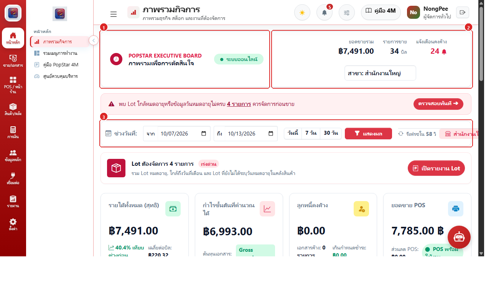
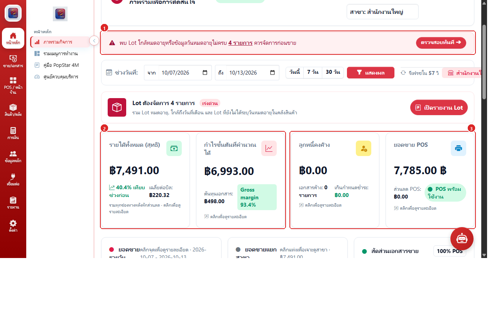
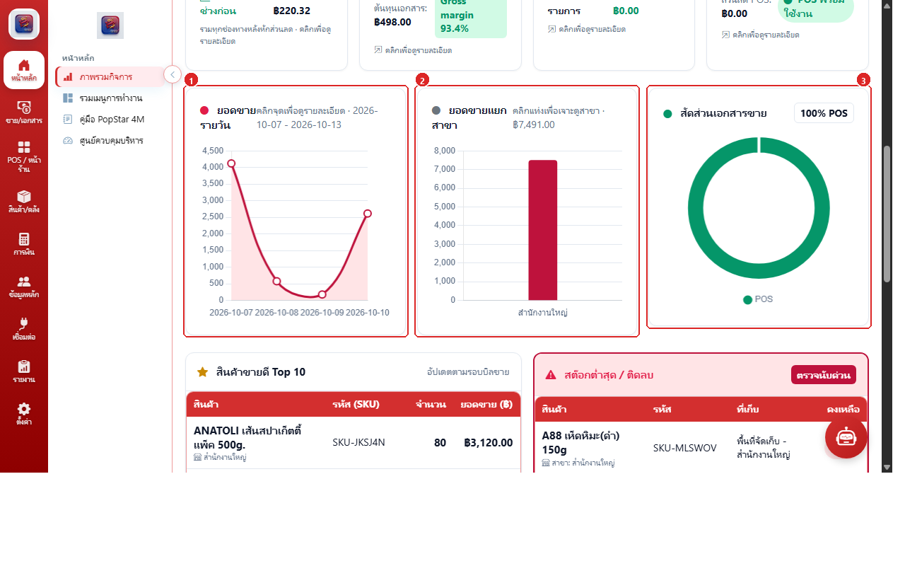
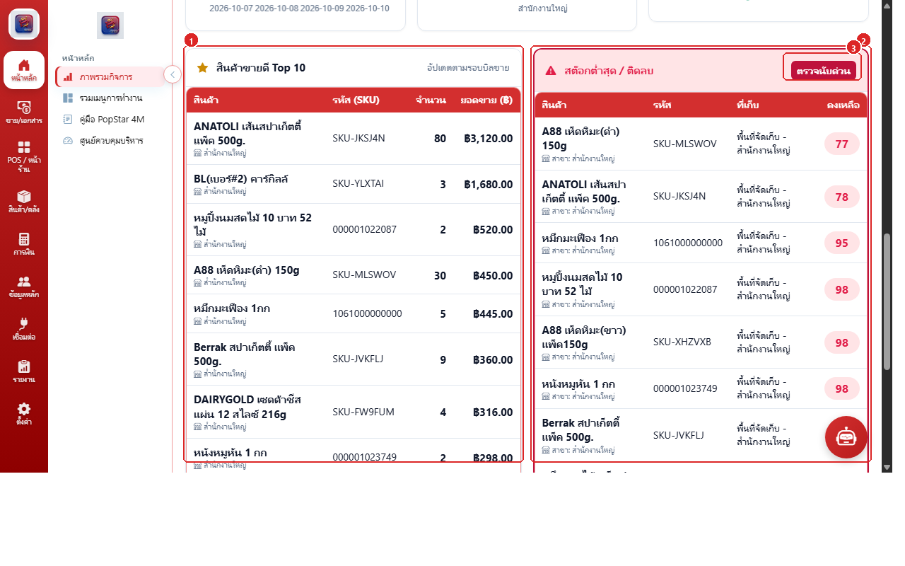
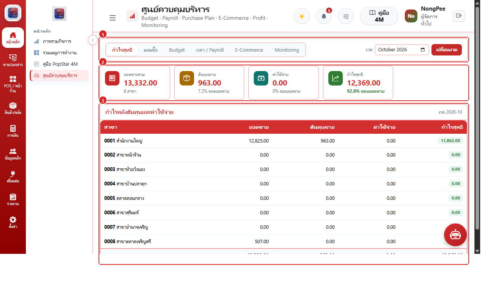
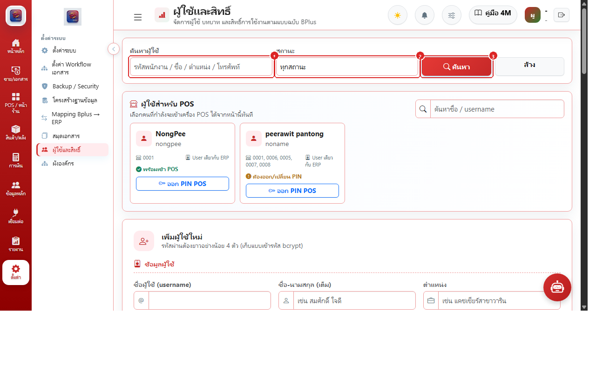
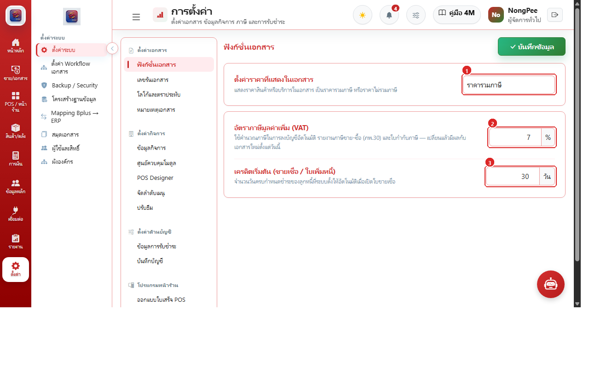

# บทที่ 1: ภาพรวมระบบและการเริ่มต้นใช้งาน (Getting Started & Overview)

บทนี้แนะนำศูนย์ควบคุมผู้บริหาร การตั้งค่าระบบ และการกำหนดสิทธิ์ผู้ใช้งานในระบบ POP ERP Food เพื่อวางรากฐานการบริหารจัดการร้านอาหารและสาขาให้ปลอดภัยและมีประสิทธิภาพ

---

## 1.1 แดชบอร์ดภาพรวมผู้บริหาร (Executive Dashboard & Controls)
**รูปภาพหน้าจอหลัก:**

ศูนย์รวมข้อมูลเชิงกลยุทธ์ของธุรกิจ ช่วยให้เจ้าของกิจการและผู้จัดการสาขาติดตามผลการดำเนินงานได้แบบ Real-time:

### ฟังก์ชันที่ 1: แดชบอร์ดภาพรวมผู้บริหาร & ตัวกรองข้อมูล

1. **ป้ายหัวข้อ & สถานะเชื่อมต่อสด:** แสดงชื่อระบบ POPSTAR EXECUTIVE BOARD พร้อมไฟสถานะ "ระบบออนไลน์"
2. **สรุปยอดขายด่วน & ตัวเลือกสลับสาขา:** ดูยอดขายรวมวันนี้, จำนวนบิลที่เปิดขาย, ยอดแจ้งเตือนคงค้าง และเมนูดรอปดาวน์เลือกสาขา
3. **แถบตัวกรองช่วงเวลา & Auto-Refresh:** ระบุช่วงวันที่จาก-ถึง, ปุ่มลัด "วันนี้", "7 วัน", "30 วัน" พร้อมระบบรีเฟรชข้อมูลอัตโนมัติทุก 60 วินาที

### ฟังก์ชันที่ 2: แถบแจ้งเตือนด่วน & 4 ดัชนีการเงินหลัก (Financial KPIs)

1. **แถบแจ้งเตือนด่วน:** แจ้งเตือนรายการวิกฤต เช่น อัตรากำไรขั้นต้นต่ำกว่าเกณฑ์ หรือสต็อกขาด
2. **การ์ดยอดขายรวม:** แสดงยอดขายสุทธิสะสม พร้อมเปอร์เซ็นต์เทียบกับงวดก่อนหน้า
3. **การ์ดกำไร ยอดคงค้าง และอัตรากำไร:** แสดงกำไรขั้นต้น, ยอดหนี้การค้าคงค้าง และเปอร์เซ็นต์ Gross Profit Margin

### ฟังก์ชันที่ 3: กราฟแนวโน้มยอดขาย & เปรียบเทียบสาขา

1. **กราฟเส้นแนวโน้มยอดขาย:** แสดงเส้นกราฟวิเคราะห์ยอดขายรายวันและรายสัปดาห์
2. **กราฟแท่งเปรียบเทียบสาขา:** เปรียบเทียบผลงานยอดขายระหว่างสำนักงานใหญ่และสาขาหน้าร้าน
3. **แท็บสลับมุมมอง & ปุ่มดาวน์โหลดกราฟ:** เลือกดูยอดขายหรือจำนวนบิล พร้อมส่งออกเป็นรูปภาพ

### ฟังก์ชันที่ 4: ศูนย์ควบคุมต้นทุน งบประมาณ & อัตรากำไร

1. **ตัวชี้วัดควบคุมต้นทุน:** วิเคราะห์สัดส่วนต้นทุนวัตถุดิบและค่าใช้จ่ายดำเนินการ
2. **แถบงบประมาณ:** ติดตามการใช้งบประมาณเทียบกับเพดานที่ตั้งไว้
3. **สถานะความปลอดภัยของมาร์จิ้น:** แจ้งเตือนเมื่ออัตรากำไรเสี่ยงต่ำกว่าจุดคุ้มทุน

### ฟังก์ชันที่ 5: แผนผังปฏิบัติการธุรกิจ 4M

1. **Man (กำลังคน):** สรุปจำนวนแคชเชียร์และพนักงานที่เข้ากะทำงาน
2. **Machine (อุปกรณ์ POS):** ตรวจสอบสถานะการออนไลน์ของเครื่องแคชเชียร์และเครื่องพิมพ์
3. **Material (วัตถุดิบ) & Method (กระบวนการ):** ติดตามสถานะสต็อกวัตถุดิบและรอบการปิดกะ

---

## 1.2 การจัดการผู้ใช้งานและสิทธิ์ความปลอดภัย (Users & Roles)

### การจัดการผู้ใช้และการกำหนดสิทธิ์

- **สร้างบัญชีผู้ใช้ใหม่:** กำหนด Username, ชื่อ-นามสกุล, อีเมล และรหัสผ่าน
- **กำหนดบทบาท (Role-based Access):**
  - `admin`: สิทธิ์ดูแลระบบสูงสุด เข้าถึงได้ทุกฟังก์ชัน
  - `manager`: สิทธิ์ผู้จัดการสาขา อนุมัติเอกสารและตรวจสอบรายงาน
  - `cashier`: สิทธิ์พนักงานแคชเชียร์หน้าร้าน ขายและเปิด-ปิดกะ
  - `store`: สิทธิ์ฝ่ายคลังสินค้า จัดการรับ-โอน-นับสต็อก
- **ผูกสังกัดสาขา:** ล็อกให้ผู้ใช้งานเข้าถึงเฉพาะข้อมูลสาขาตนเองเพื่อความปลอดภัย

---

## 1.3 การตั้งค่าระบบ สาขา และเอกสาร (Settings & System Configuration)

### การตั้งค่าทั่วไปและสาขา

1. **ข้อมูลบริษัท:** ชื่อสถานประกอบการ, เลขประจำตัวผู้เสียภาษี 13 หลัก, ที่อยู่ และโลโก้บริษัทสำหรับพิมพ์หัวบิล
2. **ทะเบียนสาขา:** รหัสสาขา, ชื่อสาขา, เลขที่สาขาตามทะเบียนภาษี (00000 สำนักงานใหญ่)
3. **การตั้งค่าเลขที่เอกสาร:** กำหนด Prefix และ Running Number สำหรับใบแจ้งหนี้, ใบเสร็จรับเงิน, และใบโอนสินค้า
