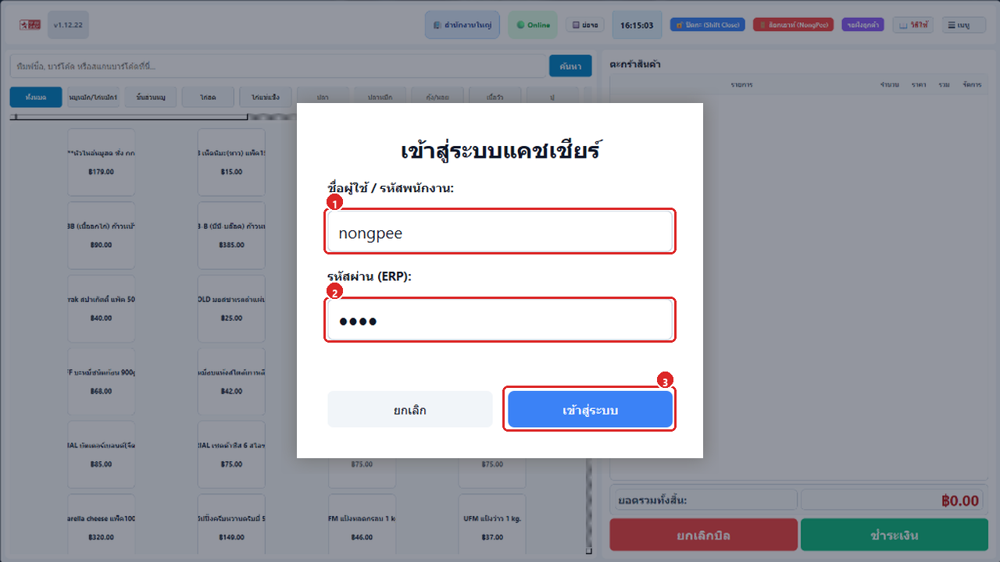
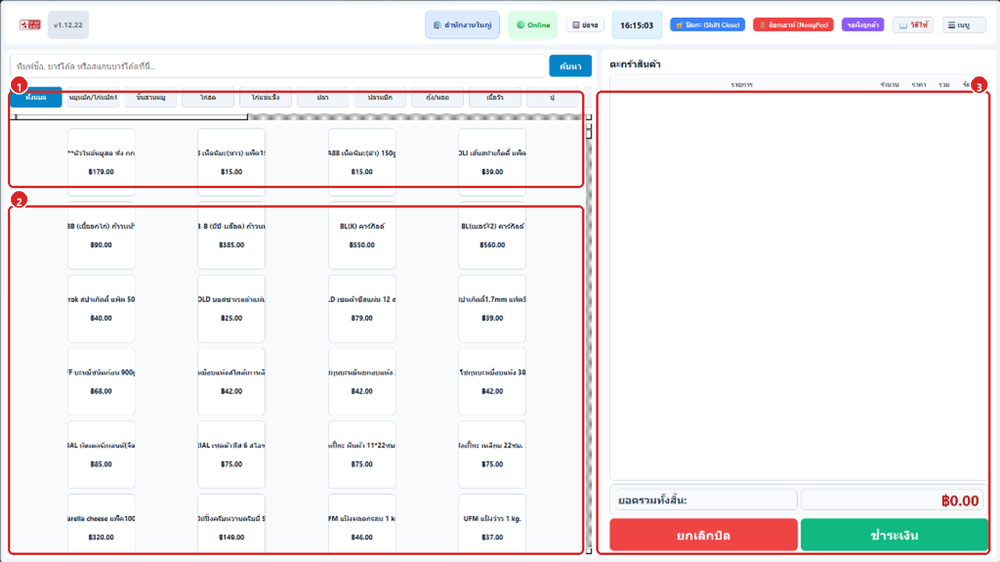
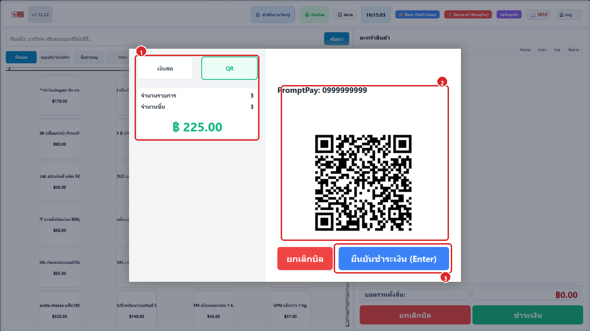
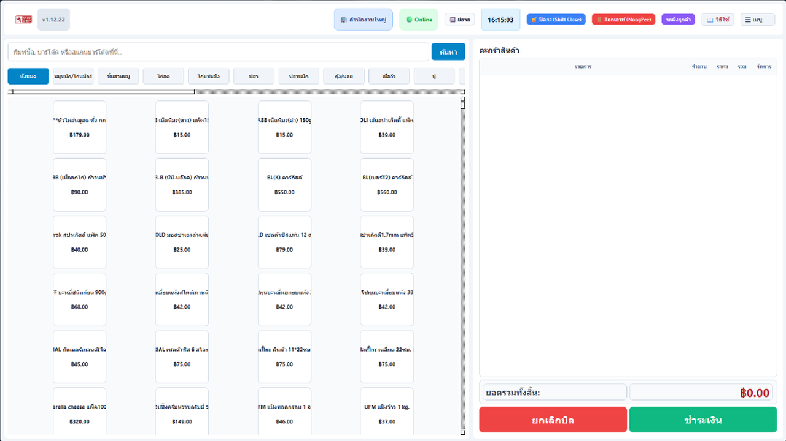
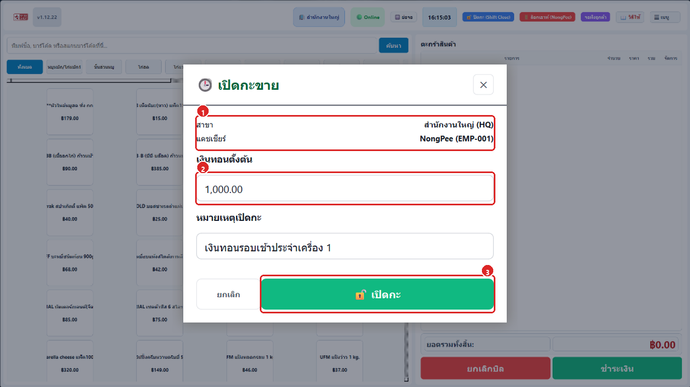
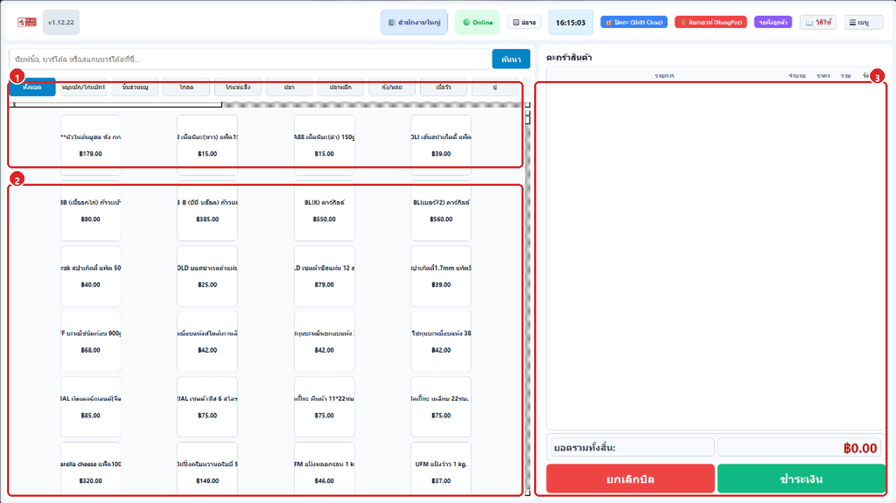
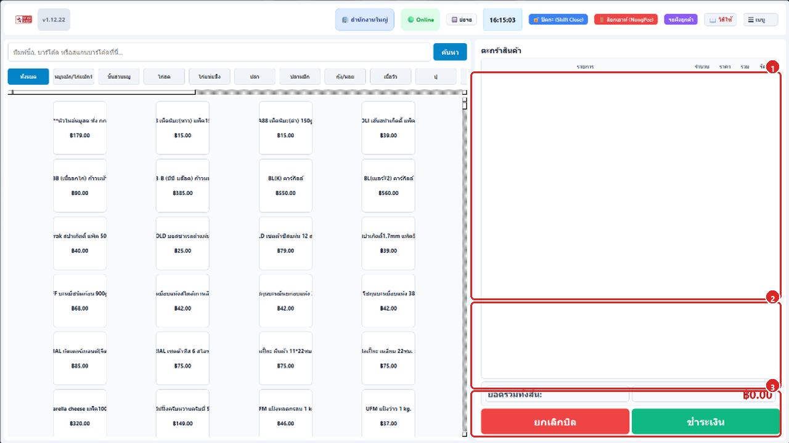
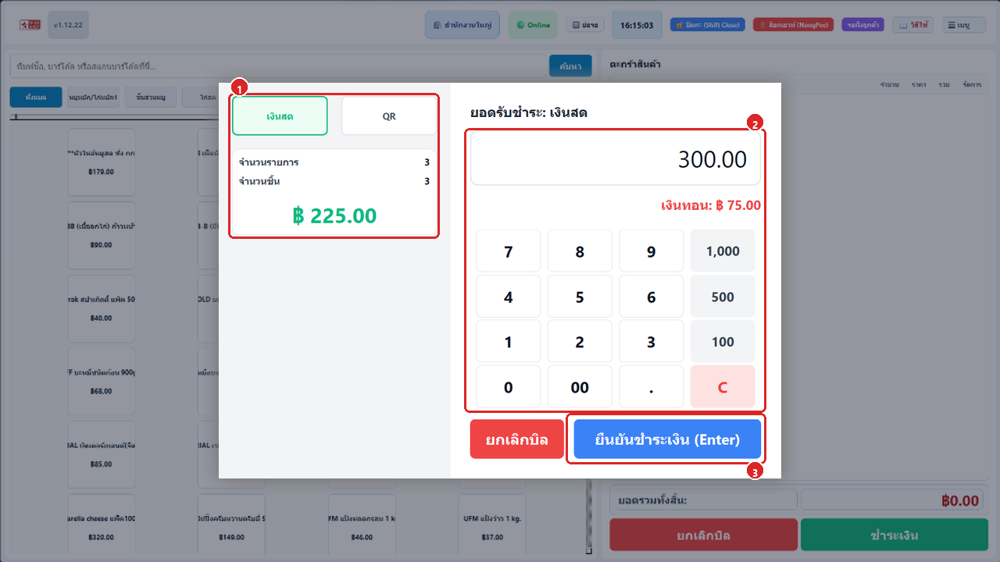
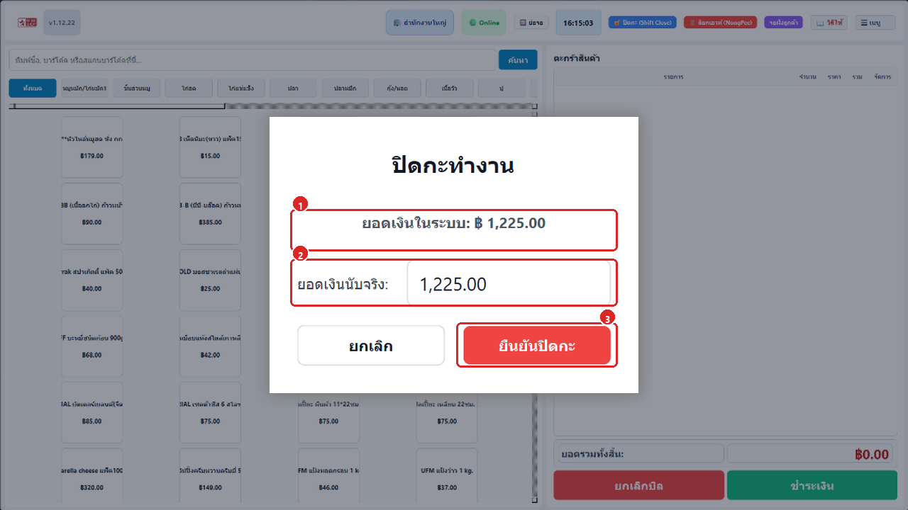

# บทที่ 2: ระบบขายหน้าร้าน (Point of Sale - JET POS)

คู่มือการปฏิบัติงานสำหรับพนักงานแคชเชียร์หน้าร้าน ครอบคลุมทั้งโปรแกรมขายหน้าร้านออฟไลน์จอสัมผัส (Python POS) และระบบขายหน้าร้านบนเว็บ (JET POS Web)

---

## 2.1 โปรแกรมแคชเชียร์ออฟไลน์จอสัมผัส (Python POS Desktop)
**รูปภาพหน้าจอหลัก:**

### ขั้นตอนที่ 1: เข้าสู่ระบบแคชเชียร์ (Cashier Login)

1. **เลือกสาขาที่ปฏิบัติงาน:** ตรวจสอบชื่อสาขาให้ถูกต้องตามที่ได้รับมอบหมาย
2. **เลือกชื่อแคชเชียร์ & ใส่รหัส PIN:** เลือกชื่อตนเองและกดแป้นตัวเลขกรอกรหัส PIN (เช่น 1234)
3. **กดปุ่ม "เข้าสู่ระบบ":** เพื่อเข้าสู่หน้าจอการทำงานหลัก

### ขั้นตอนที่ 2: เปิดกะทำงาน & บันทึกเงินทอนเริ่มต้น (Shift Open)

1. **นับเงินทอนตั้งต้น:** นับเงินสดจริงที่ใส่ไว้ในลิ้นชักเก็บเงิน
2. **กรอกจำนวนเงินทอน:** ใส่ตัวเลขลงในช่อง (เช่น 1,000.00 บาท)
3. **กดปุ่ม "🔓 เปิดกะ":** เพื่อเริ่มรอบการขายประจำวัน

### ขั้นตอนที่ 3: หน้าต่างขายหลัก & จัดการตะกร้า (Selling Screen)

1. **ยิงบาร์โค้ด / เลือกสินค้า:** สแกนบาร์โค้ด หรือแตะเลือกหมวดหมู่บนหน้าจอสัมผัส
2. **ตรวจสอบตะกร้าสินค้า:** ปรับจำนวน เพิ่ม/ลด หรือลบรายการที่ลูกค้าเปลี่ยนใจ
3. **กดปุ่ม "💳 ชำระเงิน (F12)":** เพื่อเปิดหน้าต่างคิดเงิน

### ขั้นตอนที่ 4: ชำระเงินด้วยเงินสด & คำนวณเงินทอน (Cash Payment)

1. **เลือกวิธีชำระ "เงินสด":** ตรวจสอบยอดรวมสุทธิ
2. **กรอกยอดเงินที่รับ:** กดแป้นตัวเลข หรือกดปุ่มด่วน (500, 1000) ระบบจะคำนวณเงินทอนอัตโนมัติ
3. **กดยืนยันชำระเงิน:** ลิ้นชักเก็บเงินจะเปิดออกอัตโนมัติ พร้อมพิมพ์ใบเสร็จความร้อน

### ขั้นตอนที่ 5: สแกนจ่ายด้วย Thai QR Code PromptPay

1. **เลือกแท็บ "QR":** สลับเข้าสู่โหมดรับเงินโอน
2. **แสดง QR Code:** ระบบจะสร้าง QR PromptPay ตามยอดเงินให้ลูกค้าสแกน (แสดงบนจอลูกค้า Customer Display อัตโนมัติ)
3. **กดยืนยันรับชำระ:** เมื่อตรวจสอบยอดเงินเข้าบัญชีเรียบร้อย

### ขั้นตอนที่ 6: ปิดกะทำงานสิ้นสุดวัน (Shift Close & Summary)

1. **ตรวจสอบยอดเงินในระบบ:** ดูยอดรวมเงินสดที่ขายได้ในกะ
2. **นับเงินสดจริงในลิ้นชัก:** กรอกยอดเงินที่นับได้จริง ระบบจะคำนวณยอดเงินเกิน/ขาด
3. **กดปุ่ม "ยืนยันปิดกะ":** ระบบจะพิมพ์รายงานสรุปกะ Z-Report และซิงค์ข้อมูลเข้าสู่เซิร์ฟเวอร์ ERP

---

## 2.2 ขั้นตอนการขายหน้าร้าน (JET POS)
**รูปภาพหน้าจอหลัก:**

### ขั้นตอนที่ 1: เปิดกะขาย & ใส่เงินทอนเริ่มต้น (Shift Open)

1. **ข้อมูลสาขา & แคชเชียร์:** ตรวจสอบชื่อสาขาและพนักงานผู้รับผิดชอบกะการขาย
2. **กรอกเงินทอนตั้งต้น:** ระบุจำนวนเงินสดเริ่มต้นในลิ้นชัก (เช่น 1,000.00 บาท)
3. **กดปุ่มสีเขียว "🔓 เปิดกะ":** เพื่อเริ่มต้นรอบการขายและเริ่มคิดเงินลูกค้า

### ขั้นตอนที่ 2: เลือกสินค้า / ยิงบาร์โค้ด / หมวดหมู่สินค้า

1. **ค้นหาสินค้า & สแกนบาร์โค้ด:** พิมพ์รหัส SKU ชื่อสินค้า หรือใช้เครื่องสแกนยิงบาร์โค้ดในช่องค้นหา
2. **เลือกหมวดหมู่สินค้า:** คลิกแท็บหมวดหมู่ด้านบน (ทั้งหมด, เครื่องดื่ม, ของว่าง, เมนูแนะนำ) เพื่อกรองรายการ
3. **คลิกเลือกการ์ดสินค้า:** แตะที่รูปหรือชื่อสินค้าเพื่อเพิ่มลงตะกร้าขายฝั่งขวาทันที

### ขั้นตอนที่ 3: จัดการตะกร้าสินค้า & คำนวณยอดชำระ

1. **รายการในตะกร้า & ปรับจำนวน:** ตรวจสอบรายการในตารางฝั่งขวา กดปรับจำนวน หรือลบรายการที่ไม่ต้องการ
2. **สรุปยอดเงิน & ภาษี:** ระบบคำนวณยอดรวม, ส่วนลด, ภาษีมูลค่าเพิ่ม (VAT 7%) และยอดสุทธิโดยอัตโนมัติ
3. **กดปุ่มสีน้ำเงิน "💳 ชำระเงิน (F12)":** หรือกดปุ่มลัด [F12] เพื่อเปิดหน้าต่างรับชำระเงิน

### ขั้นตอนที่ 4: ชำระเงินด้วยเงินสด & พิมพ์ใบเสร็จ (Cash Payment)

1. **เลือกวิธีชำระ "เงินสด":** ตรวจสอบการ์ดสรุปยอดเงินและจำนวนชิ้นที่ต้องชำระ
2. **ยอดเงินที่รับ & เงินทอน:** กดแป้นตัวเลขหรือปุ่มด่วน (500, 1,000) ระบบจะแสดงเงินทอนสีเขียวอัตโนมัติ
3. **กดยืนยันชำระเงิน (Enter):** บันทึกตัดสต็อก สั่งเปิดลิ้นชักเก็บเงิน และพิมพ์ใบเสร็จอัตโนมัติ

### ขั้นตอนที่ 5: ปิดกะทำงานประจำวัน (Shift Close & Z-Report)

1. **ยอดเงินในระบบ:** ตรวจสอบยอดเงินสดที่ระบบคำนวณไว้ (เงินทอนตั้งต้น + ยอดขายเงินสด)
2. **ยอดเงินนับจริง:** แคชเชียร์นับเงินสดจริงทั้งหมดในลิ้นชักและกรอกลงในช่อง
3. **กดปุ่มสีแดง "ยืนยันปิดกะ":** ระบบจะทำการปิดกะ พิมพ์ใบสรุปยอดขาย Z-Report และส่งยอดซิงค์เข้าสู่ระบบ ERP
