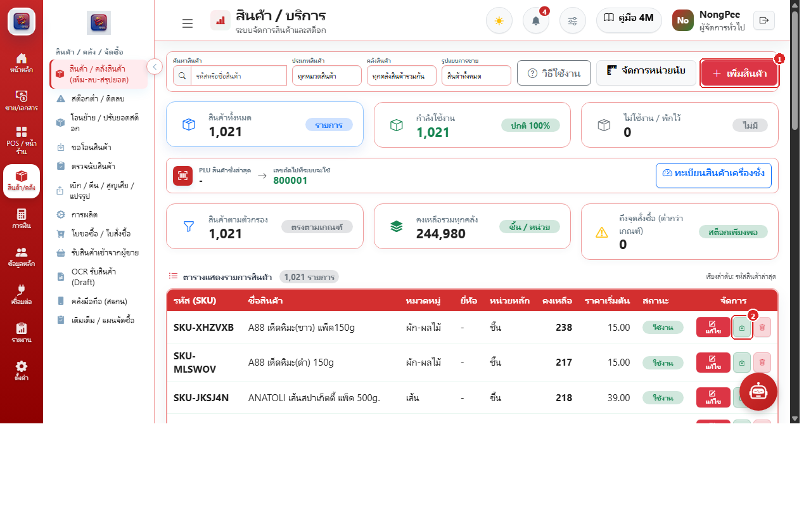
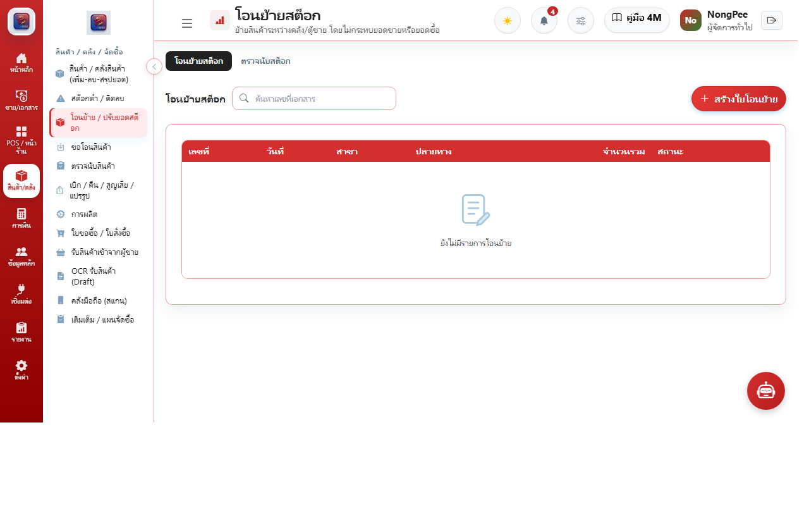
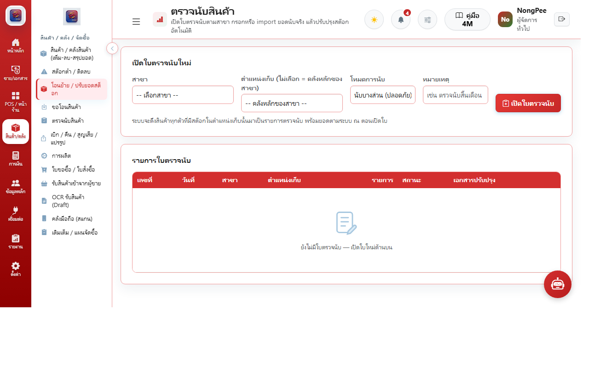
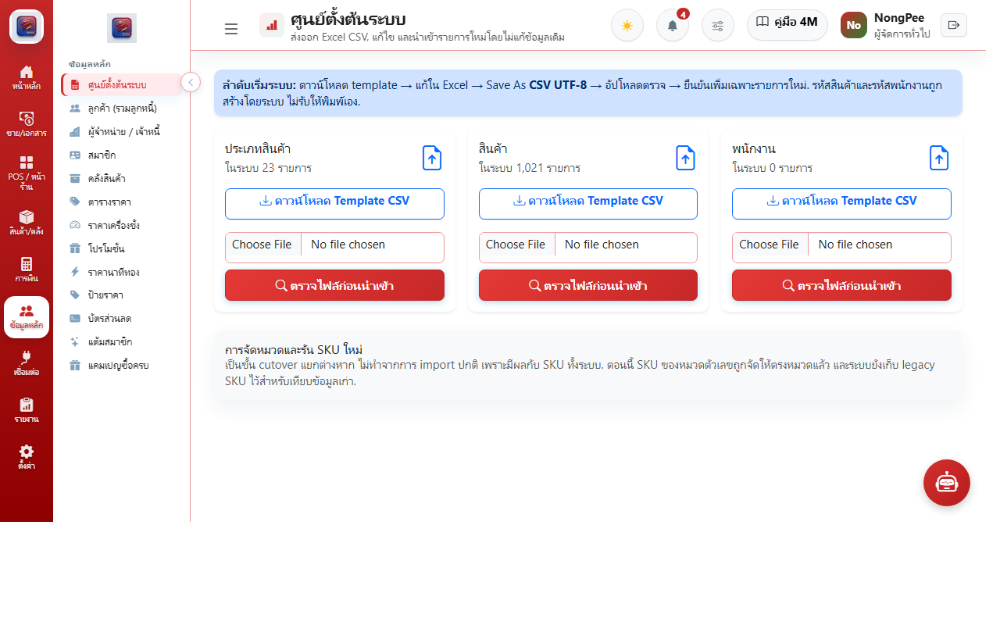

# บทที่ 3: ระบบสินค้าและคลังสินค้า (Inventory & Warehousing)

คู่มือการจัดการสต็อกสินค้า วัตถุดิบ การโอนย้ายสินค้าระหว่างสาขา การตรวจนับสต็อก และการจัดการสูตรการผลิต (BOM)

---

## 3.1 แค็ตตาล็อกสินค้าและราคา (Products Master & Pricing)

### การทำงานหลัก:
1. **ค้นหาและกรองสินค้า:** ค้นหาตาม SKU, บาร์โค้ด, หมวดหมู่ และสถานะสินค้า
2. **สร้างสินค้าใหม่:** กำหนดชื่อสินค้า, หน่วยนับ (ชิ้น, แพ็ค, กิโลกรัม), ราคาขายปลีก, และต้นทุนมาตรฐาน
3. **ตรวจสอบสต็อกคงเหลือแยกสาขา:** ดูจำนวนสินค้าพร้อมขาย (On Hand), สต็อกจอง และจุดสั่งซื้อซ้ำ (Reorder Point)

---

## 3.2 การโอนย้ายสต็อกข้ามสาขา (Stock Transfers)

### ขั้นตอนการโอนย้าย:
1. **สร้างใบขอเบิก/โอนสินค้า:** เลือกคลังต้นทาง (เช่น คลังใหญ่ HQ) และคลังปลายทาง (เช่น สาขาหน้าร้าน)
2. **เลือกรายการและระบุจำนวน:** ใส่จำนวนสินค้าที่ต้องการขนส่ง
3. **ขั้นตอนจ่ายสินค้าออกจากต้นทาง:** คลังต้นทางตรวจปล่อยสินค้า สถานะเปลี่ยนเป็น "อยู่ระหว่างขนส่ง (In Transit)"
4. **ขั้นตอนรับสินค้าเข้าปลายทาง:** สาขาปลายทางตรวจนับของจริงและกดยืนยันรับ สต็อกจะถูกเพิ่มเข้าสาขาปลายทางทันที

---

## 3.3 การตรวจนับสต็อกสินค้าจริง (Physical Stock Counts)

### ขั้นตอนการตรวจนับ:
1. **เปิดรอบตรวจนับ (Count Session):** กำหนดสาขาและหมวดหมู่สินค้าที่ต้องการนับ
2. **พิมพ์ใบนับสต็อกหรือนับผ่านแท็บเล็ต:** พนักงานเดินนับสินค้าจริงในร้าน
3. **กรอกยอดนับจริง:** เปรียบเทียบยอดในระบบกับยอดนับจริง
4. **ปรับยอดผลต่าง (Variance Reconciliation):** เมื่อผู้จัดการอนุมัติ ระบบจะปรับยอดคงเหลือให้ตรงกับความเป็นจริง พร้อมลงบันทึกบัญชีผลต่างสต็อก

---

## 3.4 ข้อมูลหลัก วัตถุดิบ และสูตรการผลิต (Master Data & BOM)

- **สูตรการผลิต (Bill of Materials):** ผูกวัตถุดิบเข้ากับเมนูอาหาร เช่น สเต็กหมู 1 จาน = เนื้อหมู 200 กรัม + เนย 20 กรัม + ซอส 50 มล.
- **ตัดสต็อกอัตโนมัติ:** เมื่อแคชเชียร์ยิงขายเมนูหน้าร้าน ระบบจะตัดสต็อกวัตถุดิบย่อยตามสูตรทันที
