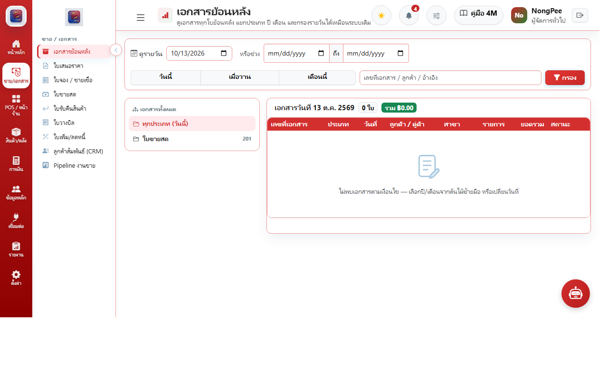
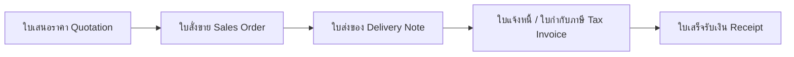

# บทที่ 4: ระบบการขายและเอกสารลูกค้า (Sales & Invoicing)

คู่มือการออกเอกสารทางการค้า การจัดการลูกหนี้การค้า และกระบวนการขายแบบ B2B / B2C

---

## 4.1 งานขายและเอกสารลูกค้าครบวงจร

### วงจรเอกสารการขาย (Sales Lifecycle):

### ฟังก์ชันสำคัญ:
1. **ใบเสนอราคา (Quotation):** กำหนดราคาสินค้า ส่วนลด เครดิตเทอม และเงื่อนไขการชำระเงิน
2. **ใบส่งของ & ใบแจ้งหนี้ (Delivery Note & Invoice):** ตัดสต็อกส่งมอบสินค้า และบันทึกตั้งลูกหนี้การค้า
3. **ใบเสร็จรับเงิน / ใบกำกับภาษีเต็มรูป (Receipt & Full Tax Invoice):** ออกเอกสารรับชำระเงินตามมาตรฐานกรมสรรพากร
4. **การรับคืนและใบลดหนี้ (Credit Note):** รองรับกรณีลูกค้าส่งคืนสินค้าหรือลดหนี้เนื่องจากสินค้าชำรุด
5. **ลูกค้าสัมพันธ์ (CRM) & Sales Pipeline:** ติดตามสถานะดีลงานขายผ่านมุมมอง Kanban Board
