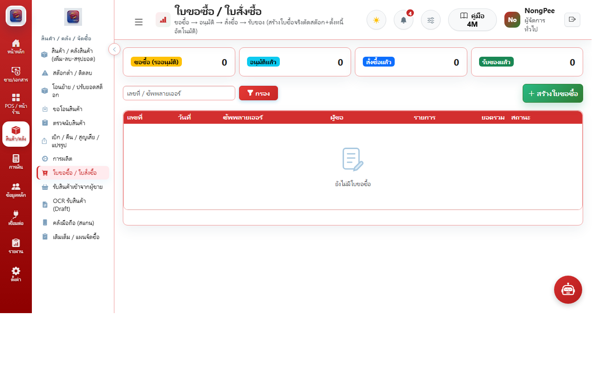

# บทที่ 5: ระบบการจัดซื้อและเจ้าหนี้ (Purchasing & Payables)

คู่มือการจัดซื้อวัตถุดิบ สินค้าเข้าร้าน การจัดการซัพพลายเออร์ และการควบคุมต้นทุนจัดซื้อ

---

## 5.1 วงจรการจัดซื้อและคลังวัตถุดิบ (Procurement Workflow)

### ขั้นตอนการจัดซื้อ:
1. **ใบขอซื้อ (Purchase Requisition - PR):** สาขาหน้าร้านหรือฝ่ายครัวสร้างคำขอสั่งซื้อวัตถุดิบเมื่อสต็อกต่ำกว่าเกณฑ์
2. **การเปรียบเทียบราคาซัพพลายเออร์ (Supplier Quotation):** บันทึกราคาจากผู้จำหน่ายหลายรายเพื่อเลือกผู้จำหน่ายที่คุ้มค่าที่สุด
3. **การอนุมัติใบสั่งซื้อ (Purchase Order - PO):** ผู้มีอำนาจอนุมัติเอกสารสั่งซื้อส่งให้คู่ค้า
4. **การรับสินค้าเข้าคลัง (Goods Receipt):** ตรวจรับของจริง ตรวจสอบวันหมดอายุ และรับสต็อกเข้าคลัง
5. **การบันทึกใบกำกับภาษีซื้อ (Vendor Invoice):** ตั้งเจ้าหนี้การค้าและบันทึกภาษีซื้อเพื่อนำไปยื่น ภ.พ.30
