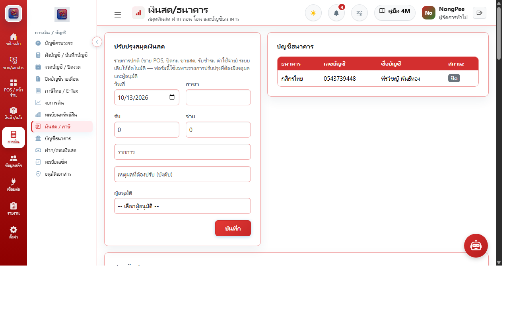
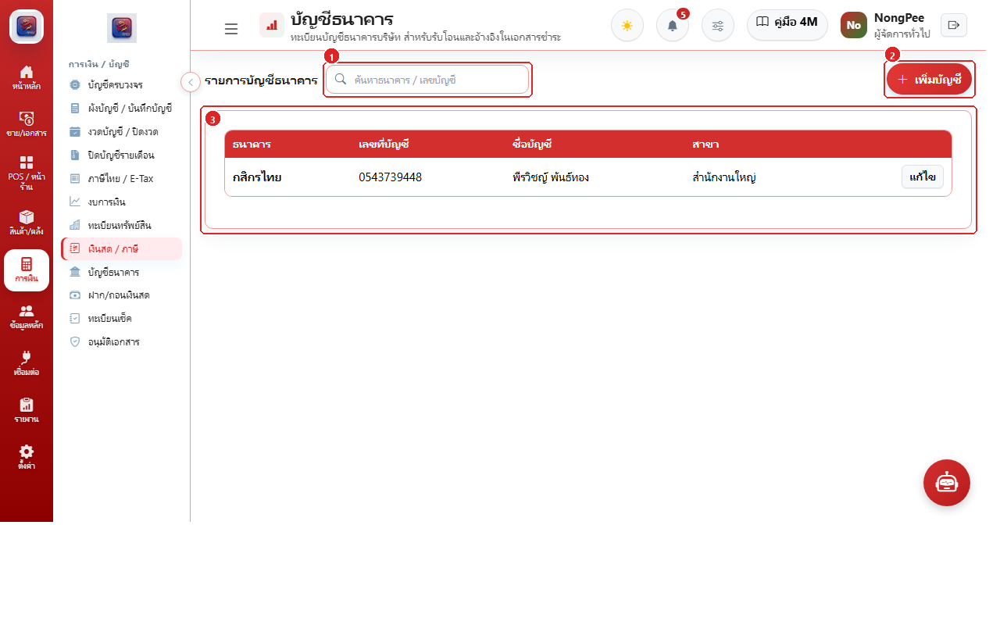
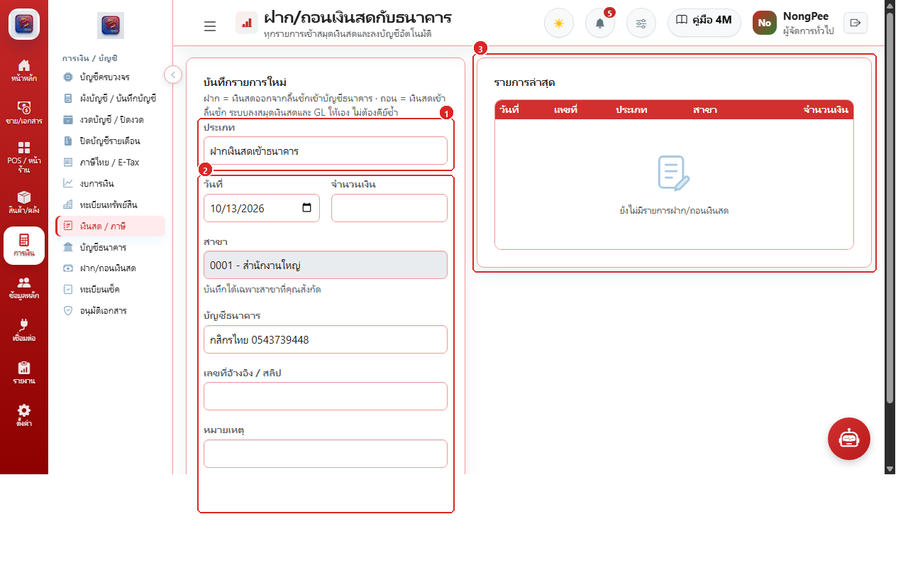
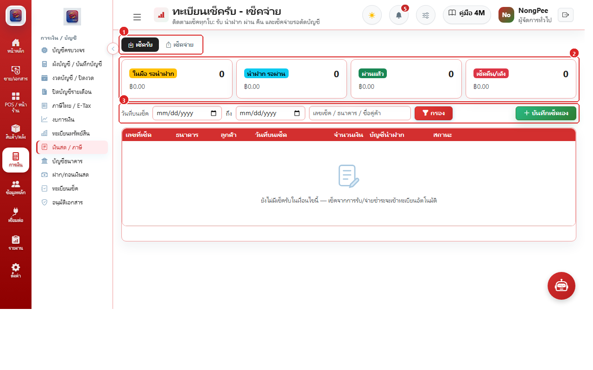
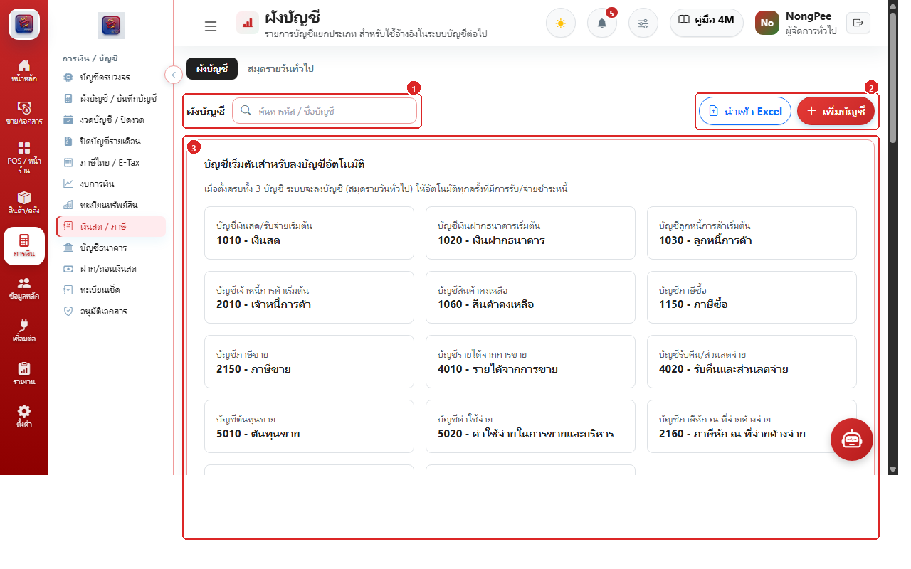
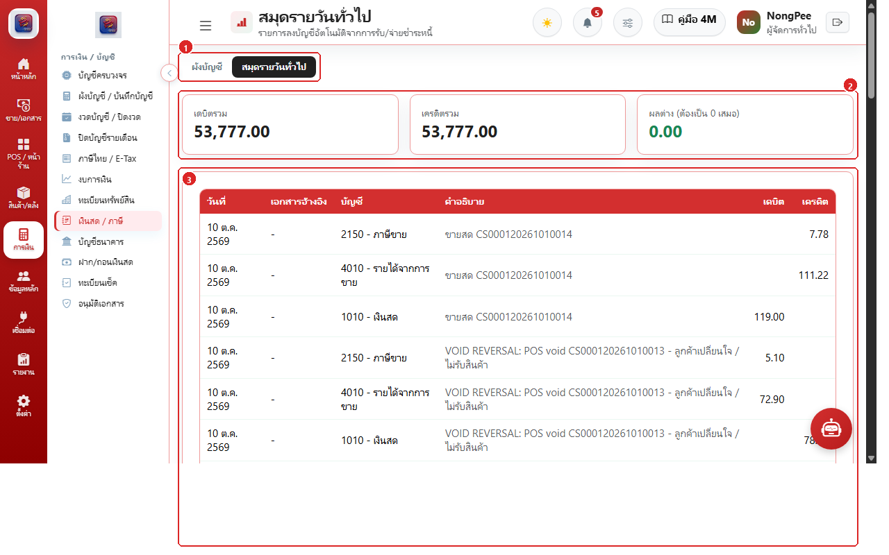
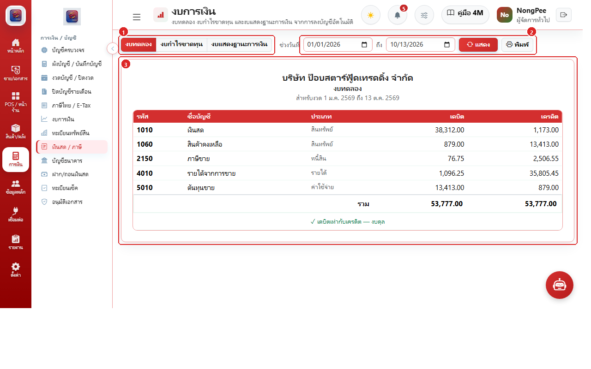
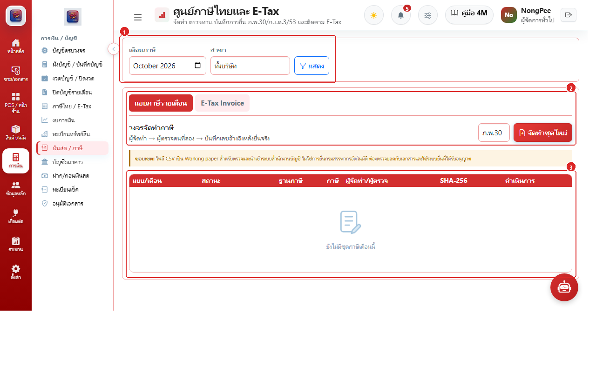

# บทที่ 6: ระบบการเงิน บัญชี และภาษี (Finance, Accounting & Tax)

คู่มือการบริหารเงินสด บัญชีธนาคาร ทะเบียนเช็ค ผังบัญชี สมุดรายวันทั่วไป งบการเงิน และศูนย์ภาษีไทยครบวงจร

---

## 6.1 หน้าจอและการทำงานหลักทั้ง 8 ฟังก์ชัน

### ฟังก์ชันที่ 1: ปรับปรุงสมุดเงินสด & รายการเงินสดประจำวัน

1. **วันที่ สาขา และยอดรับ/จ่ายเงินสด:** ระบุวันที่ทำรายการ, เลือกสาขา และกรอกจำนวนเงินสดรับเข้าหรือจ่ายออก
2. **คำอธิบาย เหตุผล และผู้อนุมัติ:** ระบุรายการความจำเป็นและเลือกผู้อนุมัติก่อนกดบันทึก
3. **ตารางบัญชีธนาคาร & สมุดเงินสด:** ตรวจสอบทะเบียนบัญชีธนาคารและประวัติรายการเงินสดในระบบ

### ฟังก์ชันที่ 2: ทะเบียนบัญชีธนาคารบริษัท (Bank Accounts)

1. **ช่องค้นหาบัญชีธนาคาร:** พิมพ์ค้นหาจากชื่อธนาคาร หรือเลขที่บัญชี
2. **ปุ่ม "+ เพิ่มบัญชี":** บันทึกสมุดบัญชีธนาคารเล่มใหม่ ระบุธนาคาร เลขบัญชี และสาขาสังกัด
3. **ตารางรายการบัญชีธนาคาร:** ดูรายชื่อธนาคาร เลขที่บัญชี และกดปุ่มแก้ไขปรับปรุงข้อมูล

### ฟังก์ชันที่ 3: บันทึกฝากและถอนเงินสดกับธนาคาร (Cash Transfers)

1. **ประเภทรายการโอน:** เลือกประเภท "ฝากเงินสดเข้าธนาคาร" หรือ "ถอนเงินสดจากธนาคาร"
2. **ข้อมูลการโอนเงิน:** ระบุวันที่, จำนวนเงิน, สาขาต้นทาง และสมุดบัญชีธนาคารปลายทาง
3. **การ์ดประวัติรายการล่าสุด:** ติดตามประวัติการฝาก/ถอนเงินสดย้อนหลัง

### ฟังก์ชันที่ 4: ทะเบียนเช็ครับและเช็คจ่าย (Cheques Register)

1. **แท็บสลับ "เช็ครับ" / "เช็คจ่าย":** เลือกระหว่างเช็ครับจากลูกค้า หรือเช็คสั่งจ่ายให้คู่ค้า
2. **การ์ดสรุปสถานะเช็ค 4 กลุ่ม:** ติดตามจำนวนและมูลค่าเช็ค (ในมือ, นำฝาก, ผ่านแล้ว, เช็คคืน)
3. **ปุ่ม "+ บันทึกเช็คเอง" & ฟิลเตอร์:** กรองค้นหาตามเลขที่เช็ค หรือบันทึกเช็คเข้าสู่ระบบ

### ฟังก์ชันที่ 5: ผังบัญชีแยกประเภท & บัญชีเริ่มต้นลงบัญชี (Chart of Accounts)

1. **ช่องค้นหาผังบัญชี:** ค้นหารหัสบัญชีหรือชื่อบัญชีทั้งภาษาไทยและอังกฤษ
2. **ปุ่ม "นำเข้า Excel" & "+ เพิ่มบัญชี":** นำเข้าชุดผังบัญชีมาตรฐาน หรือสร้างรหัสบัญชีใหม่
3. **การ์ดบัญชีเริ่มต้นสำหรับลงบัญชีอัตโนมัติ:** กำหนดคู่บัญชีมาตรฐาน (เงินสด 1010, ธนาคาร 1020, ลูกหนี้ 1030, เจ้าหนี้ 2010, รายได้ 4010, ภาษี 2150)

### ฟังก์ชันที่ 6: สมุดรายวันทั่วไป & บันทึกบัญชีแยกประเภท GL (General Journal)

1. **แท็บสลับ "ผังบัญชี" / "สมุดรายวันทั่วไป":** นำทางระหว่างผังบัญชีและรายการเดินบัญชีรายวัน
2. **การ์ดสรุปยอดเดบิต เครดิต และผลต่าง:** ตรวจสอบยอดรวมเดบิต ยอดรวมเครดิต และผลต่างต้องเป็น 0.00 เสมอ
3. **ตารางรายการลงบัญชีอัตโนมัติ:** แสดงวันที่ เอกสารอ้างอิง รหัสบัญชี และยอดเดบิต/เครดิต

### ฟังก์ชันที่ 7: งบการเงินและงบทดลองตรวจสอบยอดดุล (Financial Statements)

1. **ปุ่มสลับประเภทงบการเงิน:** เลือกดู "งบทดลอง", "งบกำไรขาดทุน", หรือ "งบแสดงฐานะการเงิน"
2. **ฟิลเตอร์ช่วงวันที่ & ปุ่มพิมพ์รายงาน:** กำหนดช่วงเวลา คำนวณสด และพิมพ์ออก PDF
3. **แผ่นงบทดลอง & สถานะตรวจสอบยอดดุล:** แสดงยอดเดบิต/เครดิตพร้อมเครื่องหมาย "✓ เดบิตเท่ากับเครดิต — งบดุล"

### ฟังก์ชันที่ 8: ศูนย์ภาษีไทยและ E-Tax Invoice (Tax Compliance)

1. **ฟิลเตอร์เดือนภาษีและสาขา:** เลือกงวดเดือนภาษีและสาขาที่ต้องการสรุปยอด
2. **แท็บแบบภาษี & วงจรจัดทำชุดใหม่:** เลือกแบบภาษี (ภ.พ.30, ภ.ง.ด.3, ภ.ง.ด.53) และกด "จัดทำชุดใหม่"
3. **ตารางแบบภาษี & เวิร์กโฟลว์ 3 ขั้น:** ติดตามขั้นตอน "Prepared" → "Reviewed" → "Submitted" พร้อมดาวน์โหลด CSV และตรวจสอบ SHA-256
