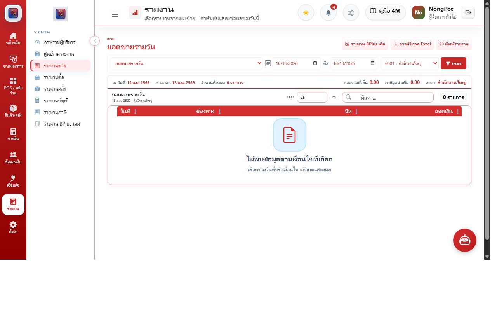

# บทที่ 7: รายงานและการวิเคราะห์เชิงบริหาร (Reports & Business Intelligence)

คู่มือการเรียกดูรายงานยอดขาย สต็อก บัญชี และการส่งออกข้อมูลสำหรับผู้บริหาร

---

## 7.1 ศูนย์รายงานและการวิเคราะห์ (Executive Analytics)

### รายงานสำคัญ 6 หมวด:
1. **รายงานยอดขายสรุปรายวันและรายเดือน (Sales Summary Reports):** วิเคราะห์รายรับตามช่วงเวลา
2. **รายงานยอดขายแยกตามช่องทางชำระเงิน (Payment Breakdown):** เปรียบเทียบสัดส่วน เงินสด vs Thai QR Code vs บัตรเครดิต
3. **รายงานจัดอันดับสินค้าขายดี (Top Best-Selling Items):** ระบุสินค้าทำกำไรสูงสุด (High Margin) และสินค้าหมุนเวียนเร็ว
4. **รายงานกำไรขั้นต้นแยกรายบิล (Gross Profit by Order):** คำนวณรายได้หักลบต้นทุนวัตถุดิบ (COGS)
5. **รายงานความเคลื่อนไหวสินค้าคงคลัง (Stock Card Movement):** ติดตามประวัติการรับเข้า จ่ายออก และยอดคงเหลือย้อนหลัง
6. **การส่งออกรายงาน (Export to Excel & PDF):** ปุ่มส่งออกข้อมูลเป็นไฟล์ Excel (.xlsx) และไฟล์สเปรดชีตสำหรับการทำบัญชีภายนอก
