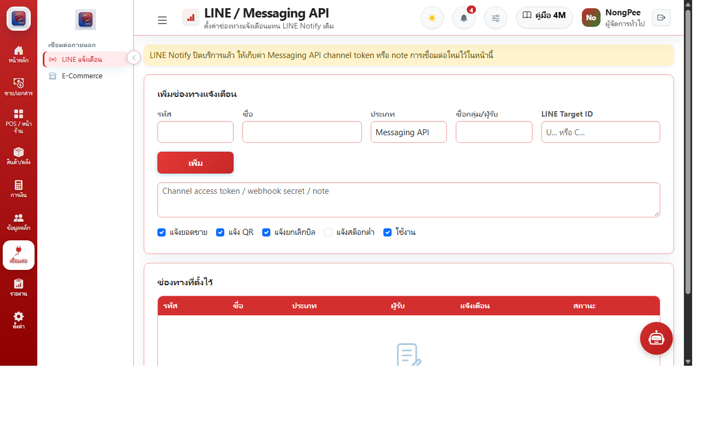

# บทที่ 8: การเชื่อมต่อภายนอกและการดูแลระบบ (Integrations & Operations)

คู่มือการเชื่อมต่อระบบแจ้งเตือนภายนอก Webhook, API และการสำรองข้อมูลความปลอดภัย

---

## 8.1 การเชื่อมต่อภายนอก (Third-Party Integrations)

### ฟังก์ชันการทำงาน:
1. **LINE Notify:** แจ้งเตือนยอดขายประจำวัน, การเปิด-ปิดกะของแคชเชียร์, และการเตือนสต็อกใกล้หมดเข้ากลุ่มไลน์ผู้บริหารแบบอัตโนมัติ
2. **Webhooks & REST APIs:** เชื่อมต่อระบบสั่งอาหารเดลิเวอรี และแอปพลิเคชันสมาชิก
3. **การสำรองข้อมูลอัตโนมัติ (Automated Database Backup):** แผนกู้คืนระบบจากภัยพิบัติ (Disaster Recovery) พร้อมการตรวจสอบ Checksum และเข้ารหัสข้อมูล
